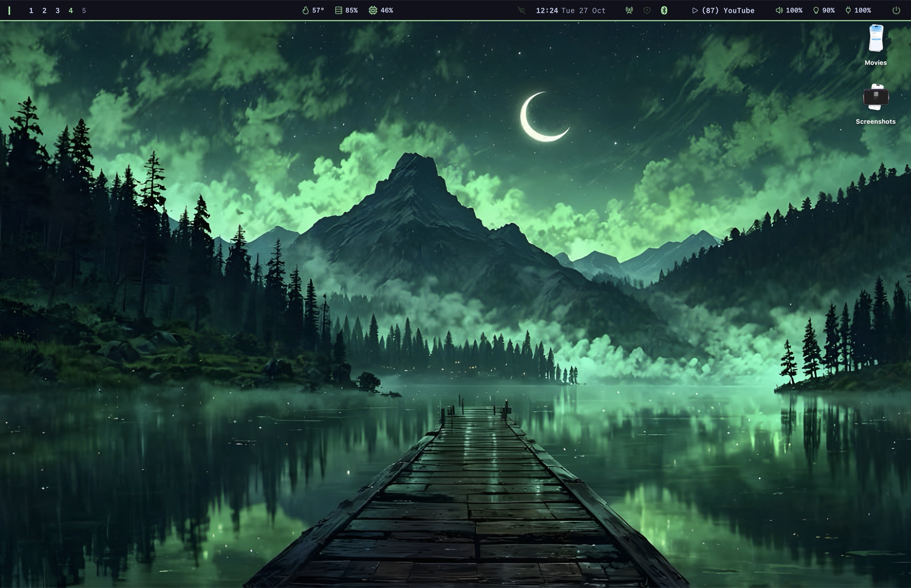
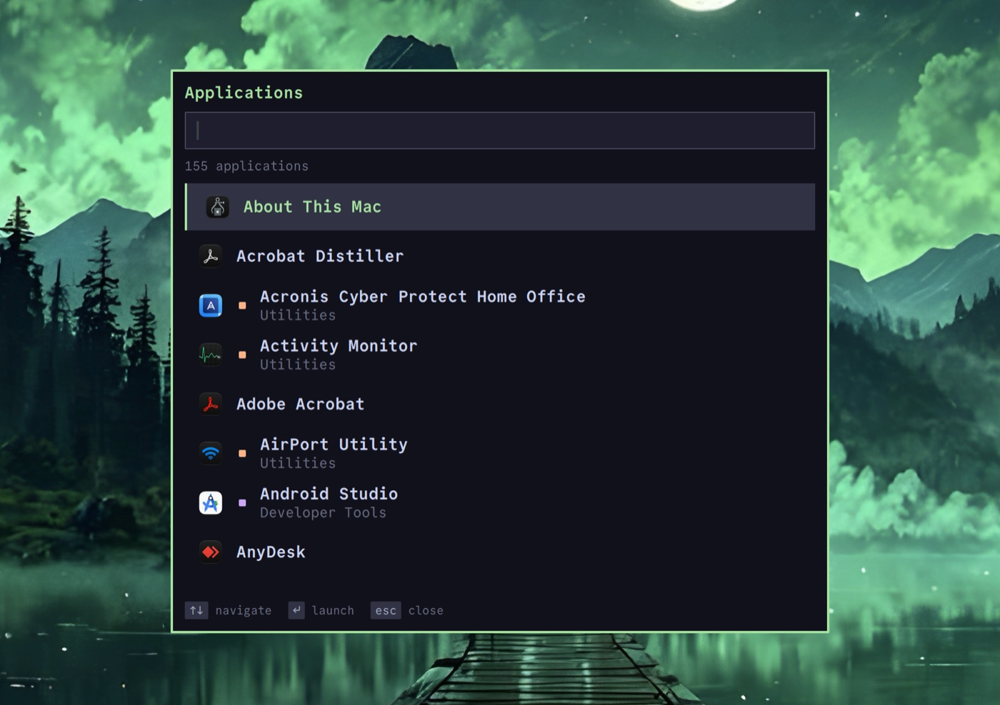
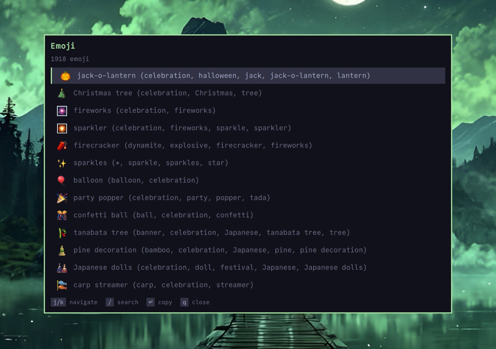
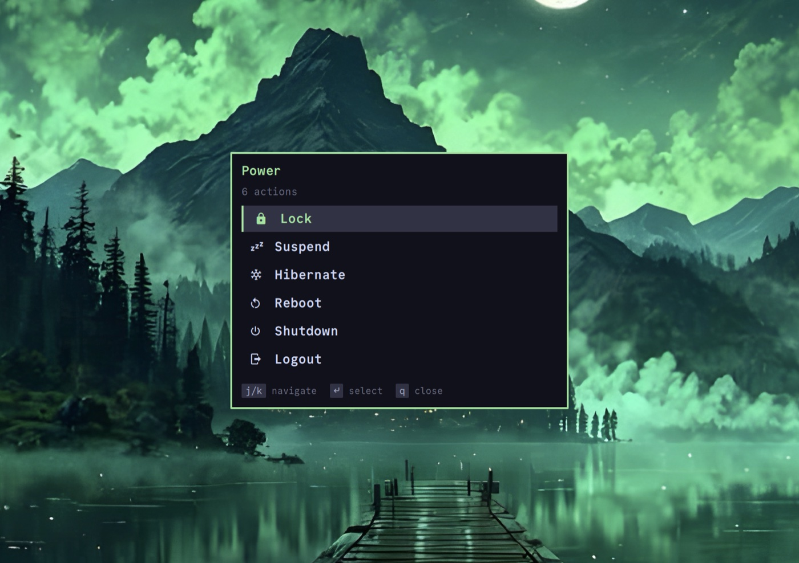

My [dotfiles](https://github.com/Green-Ranger11/dotfiles) run on two machines: Arch with Hyprland, and a Mac with yabai and skhd. On Linux, the bar, launcher, clipboard picker, Bluetooth and Wi-Fi menus are all one [Quickshell](https://quickshell.org) config written in QML. On the Mac I had nothing like it, and Quickshell only runs on Wayland and X11.

[Laumei](https://github.com/Green-Ranger11/laumei) fixes that. It runs Quickshell configs on macOS. This is the same config on my Mac:



## What it is

Laumei is a separate runtime, not a fork of Quickshell. It provides Quickshell's QML modules (`Quickshell`, `Quickshell.Io`, `Quickshell.Wayland`, `Quickshell.Hyprland`, `Quickshell.Services.*` and so on) on top of plain Qt 6, backed by macOS APIs. A config written for Quickshell loads unchanged, and the `laumei` command has the same CLI as `qs`:

```sh
laumei -c mac                        # ~/.config/quickshell/mac/shell.qml
laumei -c mac ipc call launcher toggle
laumei -c mac kill
```

## What it looks like

The bar shows yabai workspaces, CPU temperature, memory and CPU use, the clock, network, Bluetooth, now playing, volume, brightness and battery. Each widget is the Linux one, unchanged:


The pickers open from skhd keybindings through `laumei ipc call`. The app launcher lists `.app` bundles:



The emoji picker copies with the `wl-copy` stand-in:



The power menu maps `systemctl` and `loginctl` to macOS:



## How it maps to macOS

- **Windows.** `PanelWindow` becomes a borderless window placed from its `anchors` and `margins`. The layer shell layer picks the window level, so an `Overlay` panel sits above the menu bar.
- **Workspaces.** `Quickshell.Hyprland` is backed by yabai or AeroSpace. A workspace widget written for Hyprland shows your yabai spaces.
- **System services.** Audio comes from CoreAudio, battery from IOKit, Wi-Fi from CoreWLAN and Bluetooth from IOBluetooth. Media uses [`media-control`](https://github.com/ungive/media-control) because Apple locks down MediaRemote.
- **Linux commands.** Configs call tools like `wl-copy`, `notify-send`, `brightnessctl` and `systemctl suspend`. Laumei puts small stand-ins first on `PATH` that do the macOS equivalent. `wl-paste --watch cliphist store` still keeps a clipboard history.
- **`/proc` and `/sys`.** `FileView` fakes the files bars usually read, such as `/proc/stat`, `/proc/meminfo` and the CPU temperature, so system stats widgets work as they are.
- **Hot reload.** Every QML file the shell loads is watched. A failed reload keeps the running config.

## What it can't do

Some Quickshell features have no macOS equivalent. Their types still exist, so a config loads, but they do nothing:

- **Notification server.** macOS gives no way for another app to receive notifications.
- **System tray.** macOS draws every menu bar item into one shared window, so there are no per-item icons to mirror.
- **Custom lock screens.** Locking hands off to the macOS lock screen. Only that one is trusted for Touch ID and FileVault.
- **Exclusive zones.** A window can't reserve screen space. Set it in the window manager instead, e.g. yabai's `external_bar`.
- **Global shortcuts.** Bind keys in skhd to `laumei ipc call` instead.

## Sharing one config

A Linux config loads as it is, and the parts macOS can't do stay inert. To leave out Linux-only pieces, I give the Mac its own `shell.qml` that imports the shared widgets:

```qml
// ~/.config/quickshell/mac/shell.qml
import Quickshell
import "../mocha/launcher"

ShellRoot {
    AppLauncher {}
    EmojiPicker {}
}
```

Widgets that call the shell's own CLI pick the command by platform:

```qml
readonly property string shellCommand: Qt.platform.os === "osx" ? "laumei" : "qs"
```

## Try it

Laumei needs Qt 6.5+ and CMake:

```sh
brew install qt cmake ninja
cmake -S . -B build -G Ninja -DCMAKE_PREFIX_PATH=$(brew --prefix qt)
cmake --build build
cmake --install build --prefix ~/.local
```

The README in the [repo](https://github.com/Green-Ranger11/laumei) has the full list of supported modules.
